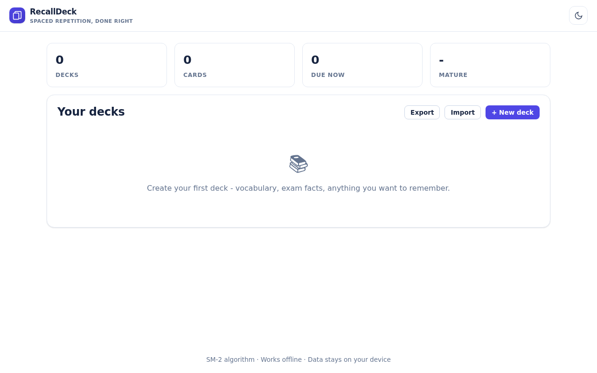
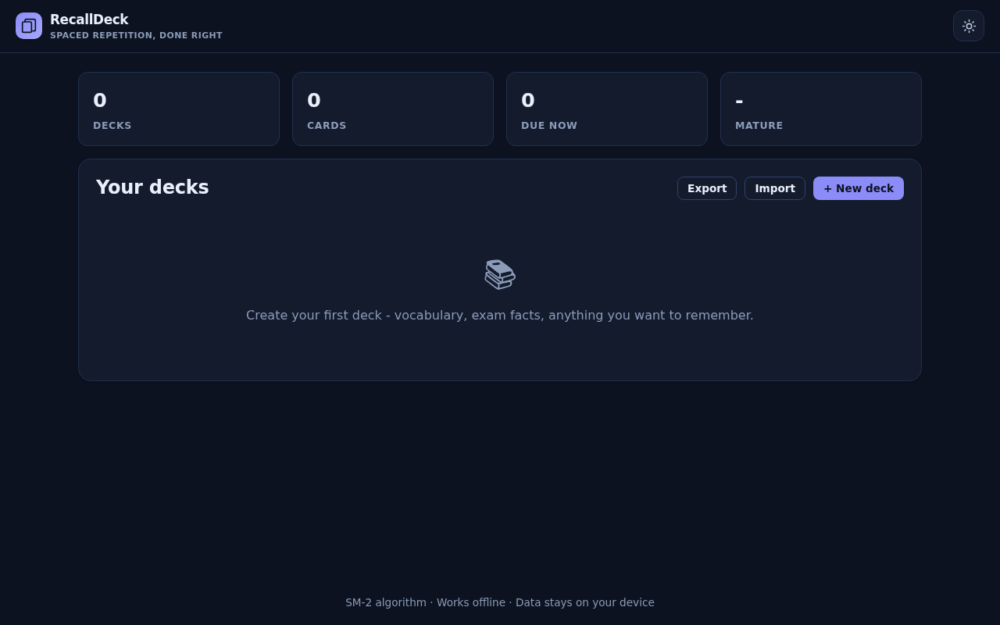
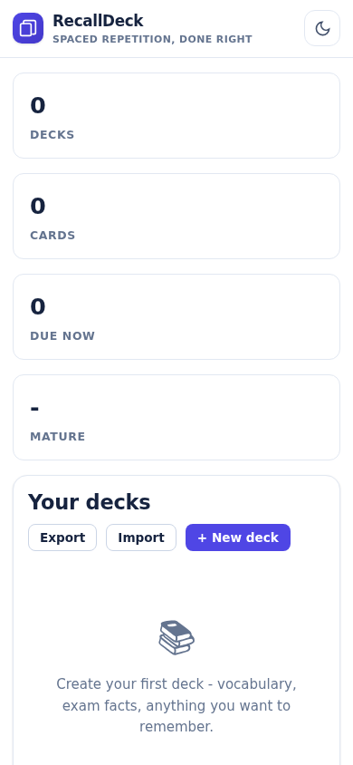

# RecallDeck - Spaced Repetition Flashcards

Learn anything with an SM-2 spaced repetition engine, decks, interval previews, and JSON or TSV/CSV import.

**Live:** https://akash991833.github.io/spaced-repetition-flashcards/

## Screenshots

| Desktop (light) | Desktop (dark) | Mobile |
| --- | --- | --- |
|  |  |  |

## Features

- SM-2 algorithm with 4 answer grades
- Per-card interval, ease and due-date preview
- Decks with progress and due counts
- JSON and TSV/CSV card import
- Review session with keyboard shortcuts
- Dark and light themes, offline PWA

## Tech

Vanilla HTML/CSS/JS - no build step, no dependencies, no tracking. Installable PWA with a service worker, works fully offline. All data stays on your device.

## Run locally

Open `index.html` in a browser, or serve the folder with any static server:

```bash
npx serve .
```

## Honest limits

Cards and scheduling state live in localStorage on this device.
